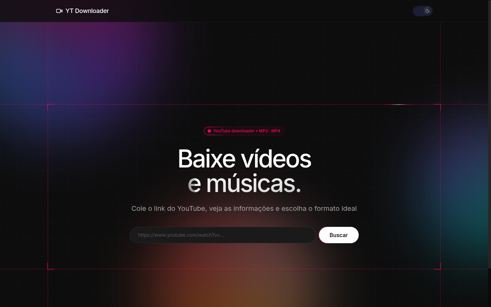
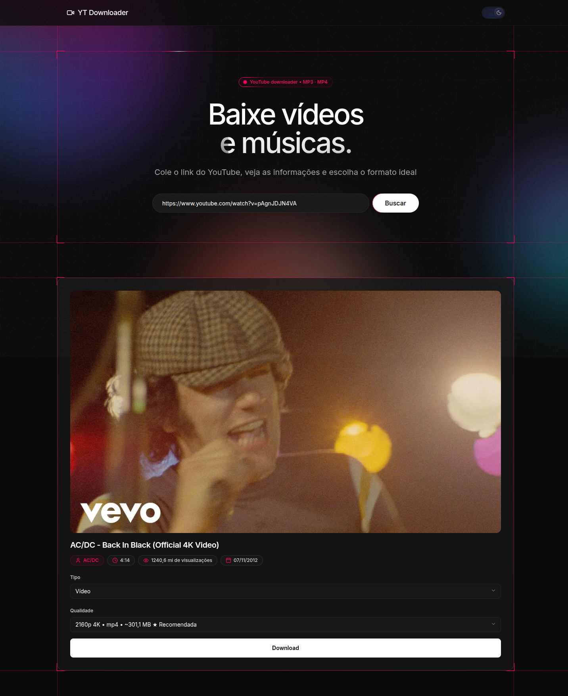
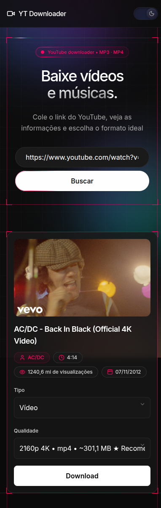

# YT Downloader


Página web local para colar um link do YouTube, ver detalhes (thumbnail, canal, duração, views, data) e baixar em **MP4** (vídeo) ou **MP3** (áudio). Roda local ou via Docker, com proteções contra rate-limit do YouTube e layout responsivo mobile.

## Sumário

- [Demonstração](#demonstração)
- [Funcionalidades](#funcionalidades)
- [Tecnologias](#tecnologias)
- [Pré-requisitos](#pré-requisitos)
- [Como executar](#como-executar)
- [Como usar](#como-usar)
- [API](#api)
- [Estrutura do projeto](#estrutura-do-projeto)
- [Testes e qualidade](#testes-e-qualidade)
- [Segurança e anti-bloqueio](#segurança-e-anti-bloqueio)
- [Limitações](#limitações)
- [Licença](#licença)

## Demonstração

### Desktop





### Mobile



*Busca de exemplo: [AC/DC – Back In Black (Official 4K Video)](https://www.youtube.com/watch?v=pAgnJDJN4VA)*

## Funcionalidades

- 🔍 **Busca por link** com thumbnail, título, canal, duração, views e data de publicação (em pt-BR)
- 🎬 **Vídeo MP4** com qualidades agrupadas por resolução (melhor → pior, 1 por resolução)
- 🎵 **Áudio MP3** (transcode via ffmpeg) em faixas Alta / Média / Baixa por bitrate
- 🏷️ Tamanhos estimados (`~`) e badge **★ Recomendada** na melhor opção
- 📱 **Responsivo**: layout empilhado no mobile, sem zoom automático do iOS, alvos de toque de 48px
- 🌗 Tema claro/escuro com persistência
- 🛡️ **Anti-bloqueio leve**: cache em memória (15 min), extração única, retry com backoff + jitter, rate-limit por IP

## Tecnologias

| Camada | Stack |
|---|---|
| Backend | FastAPI (async), yt-dlp, ffmpeg (pipe, sem arquivo temporário) |
| Frontend | HTML + Tailwind (CDN), vanilla JS, Lucide/Iconify |
| Infra | Docker (`python:3.12-slim`), `USER app`, `HEALTHCHECK` |
| Qualidade | pytest (71 testes), ruff |

## Pré-requisitos

- Python 3.12 **ou** Docker
- ffmpeg (só no modo local: `sudo apt install ffmpeg` / `brew install ffmpeg`)

## Como executar

### Local

```bash
python3 -m venv .venv
.venv/bin/pip install -r requirements_dev.txt
.venv/bin/uvicorn app.main:app --port 8000
```

Abrir http://localhost:8000

### Docker

```bash
docker build -t yt-downloader .
docker run -d -p 8000:8000 yt-downloader
```

Abrir http://localhost:8000

## Como usar

1. Cole o link do vídeo no campo de busca e clique **Buscar**
2. Confira thumbnail, título e badges (canal, duração, views, data)
3. Escolha o **Tipo** (Vídeo ou Áudio MP3) e a **Qualidade**
4. Clique **Download** — o arquivo baixa direto no PC

## API

| Método | Endpoint | Descrição |
|---|---|---|
| `GET` | `/api/info?url=<youtube-url>` | Metadados + formatos agrupados (limite: 20 req/min por IP) |
| `GET` | `/api/download?url=<...>&format_id=<...>&audio_only=<true\|false>` | Stream do download (limite: 10 req/min por IP, máx. 3 simultâneos) |
| `GET` | `/health` | Sonda de monitoramento → `{"status": "ok"}` |
| `GET` | `/` | Interface web |

Respostas de erro seguem o padrão FastAPI (`{"detail": "..."}`); excesso de uso retorna `429`/`503` com header `Retry-After`.

## Estrutura do projeto

```
.
├── app/
│   ├── main.py        # FastAPI: /api/info, /api/download, /health, rate-limit, CSP
│   └── yt.py          # yt-dlp: extração, cache TTL, retry/backoff, agrupamento
├── static/
│   ├── index.html     # UI (FormFlow)
│   ├── app.js         # fetch/render, ordenação melhor→pior, badges, dockHero
│   └── styles.css     # tokens do design system + responsivo
├── tests/             # pytest (info, download, antiblock, frontend, saúde)
├── docs/screenshots/  # prints usados neste README (fora da imagem Docker)
├── Dockerfile         # python:3.12-slim + ffmpeg, USER app, HEALTHCHECK
├── requirements.txt
├── pyproject.toml     # ruff + pytest
└── LICENSE            # MIT
```

## Testes e qualidade

```bash
.venv/bin/python -m pytest -q
.venv/bin/ruff check .
.venv/bin/ruff format --check .
```

Auditoria de código própria com veredito **PASS** antes de cada merge na branch.

## Segurança e anti-bloqueio

- Validação de hostname (só domínios YouTube), erros genéricos (sem vazar stack)
- Cache bounded (500 entradas + TTL + deepcopy), rate-limit por IP com teto de chaves
- Semáforo de 3 downloads simultâneos (`503` + `Retry-After` quando lotado)
- Headers de segurança incluindo CSP; sem cookies e sem conta — nada sai do seu PC além da consulta ao YouTube

## Limitações

- **Vídeo MP4 com áudio Opus**: o YouTube serve vídeo/áudio separados (DASH); o remux (`-c copy`) é rápido e sem perda, mas o MP4 resultante contém áudio Opus, não AAC. **Safari não reproduz Opus em MP4**. Use VLC, Firefox ou Chrome, ou baixe o MP3 separado para máxima compatibilidade.
- **MP4 fragmentado**: downloads usam `-movflags frag_keyframe+empty_moov` para streaming via pipe. Players antigos (Windows Media Player pré-Win10) podem não reconhecer; browsers modernos e VLC funcionam.
- **Transcode MP3**: ~1s de overhead do ffmpeg por download de áudio.
- **Rate-limit do YouTube**: em caso de `429`, aguarde o `Retry-After` e tente de novo; o cache evita reconsultas repetidas.

## Licença

Projeto educacional para portfólio, focado em API assíncrona com FastAPI, streaming sob demanda e separação em camadas (web + serviço).

Distribuído sob a [Licença MIT](LICENSE).

> ⚠️ Respeite os Termos de Serviço do YouTube e os direitos autorais. O uso indevido é responsabilidade do usuário final.
